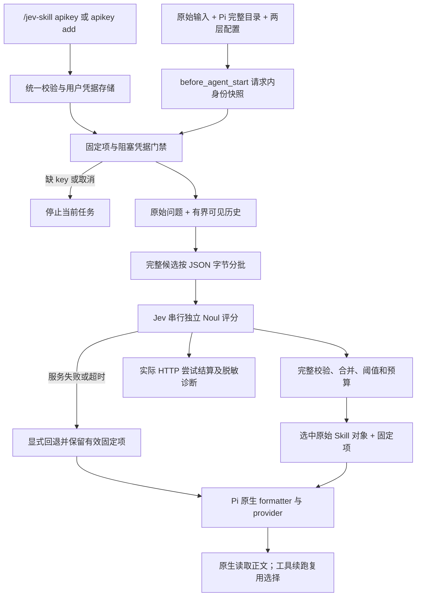

# Jev Skills Retrieval

## 项目概要

本项目是 Pi 1.3.0 原生 TypeScript 扩展：Jev 对完整技能 metadata 评分，Pi 原生 formatter 和工具负责加载与读取技能正文。项目与包名为 `jev-skills-retrieval`，兼容接口仍使用旧标识，见[架构](docs/architecture.md)。

README 只保留用途、最短上手、关键结果和文档入口。[配置](docs/configuration.md)、[开发](docs/development.md)、[评测操作](benchmark/README.md)与[历史验证](docs/verification.md)各自维护细节。

## 项目目标和边界

- 正常用户请求只路由一次，工具续跑复用选择；每条新请求创建新的路径身份快照。固定路径和显式 `/skill:name` 优先，正文仍由 Pi 原生处理。
- 成功零命中与服务失败不同。服务错误显式回退；缺 key、取消、无 UI 或保存失败阻塞/取消当前任务，不向聊天 provider 继续发送。凭据等待不计入路由 deadline。
- 完整候选按 JSON 字节保护分批；同一查询批次串行，默认完成后间隔 1 秒。全部评分成功后统一筛选，不把部分覆盖伪装成正常结果。生产 SDK 重试为 0；BM25/向量预筛选尚未实现。
- 默认准备/评估/总时限为 5/10/15 秒，单批 10 秒；48,000 字节 payload、24,000 字节 state+单题、128 批是本地保护，不是服务 Token 上界。较大目录需显式配置；不可静默延长操作者给出的 guard。
- 不承诺运行中插话、接管加载扩展前的历史会话、其他 harness 或删除历史技能正文。扩展历史只留用户原文和助手可见文本，不读工具结果、思考或正文。
- Jev 使用官方 SDK，默认显式模型 `jev-1.14.0`。key 优先 `TYPESAFE_API_KEY`，其次专用用户文件 `~/.jev-skill-router/credentials.json`，再交互输入。Windows DPAPI/POSIX 权限隔离；秘密不进入项目配置、模型会话、报告或子进程参数，不自动落盘环境 key。支持 `/jev-skill apikey add <apikey>` 直接保存；该命令在 Pi 编辑器中明文输入，可保留于编辑器本地输入历史。退出只清内存。
- Jev 地址顺序：项目配置 > 用户配置 > `TYPESAFE_BASE_URL` > 官方默认；SDK 接收 API 根地址，附加 `/v1/systemone`。地址不是代理。旧 `.pi/skill-router.json`、`/jev-skill`、`/skill-router-status`、会话类型 `jev-skill-router` 保持兼容。
- 若新增通用大模型接口，优先 `LLM_API_KEY` / `LLM_BASE_URL` 和 OpenAI Chat Completions。现有真实 benchmark 必须使用 Pi 原生 OpenAI OAuth `gpt-6-luna` / `medium`，不能用通用地址或 API-key provider 替换；Jev 为独立服务。
- 只记真实已派发 HTTP；批次尝试结算回调负责成本，最终报告不重复累加。保留失败前已知 usage；未知不是零，完整总量及 tokens/success 保持未知。缓存计一次，reasoning 是 output 子集，Token 不是账单。
- `benchmark/parallel/` 协议 3 两组各有 N 个 worker（N=3/5），单查询批次仍串行；HTTP 首次加 5 次重试，共 6 次，5/10/20/40/80 秒加 0–20% 抖动，尊重 Retry-After、共享冷却、等待释放槽位。SDK 本身零重试。服务重试耗尽时 Pi 暂停两组，Jev 仅插件组；任务 guard 只暂停该任务。新恢复轮或追加预算需明确操作，重启不重置历史。旧协议 2 的不同规则见评测文档，不得混用。
- 检查点只重放本实验语义匹配的成功响应；已完成查询不可再次调度。`coordinator.jsonl` 为权威日志，派生结果不代替它。源码迁移必须显式、停机并通过兼容门禁；不得自动篡改指纹或导入旧实验。
- 当前两组运行已由用户停止并冻结，不自动恢复。原始 `outputs/benchmark/frozen/` 不修改、不入 Git。用户明确批准的 212 对查询精选派生包位于 `docs/benchmarks/2026-10-19-skillret-paused-212/`，主样本与 199 对完整用量子集分开报告；不是全量榜单或实际任务成功率。
- SkillsBench 87 项中 `fix-druid-loophole-cve/verifier/test_outputs.py` 因 CVE 载荷被安全软件阻断（ID `A9E32DDD4DA1FF17`）。不自动恢复、解压或执行，不称已确认误报；保留 86 已核验+1 阻断和原始分母，完整 live 在付费调用前停止。

## 项目结构

```text
.
+-- src/
|   +-- pi-adapter.ts          # Pi 生命周期、目录快照、诊断
|   +-- selection.ts           # 路径身份、去重、固定项与预算选择
|   +-- router.ts              # 凭据等待外的路由阶段与时限
|   +-- batching.ts            # 完整候选装包、串行调度与评分合并
|   +-- jev-client.ts          # 官方 SDK、响应校验和 usage
|   +-- context.ts             # 原始输入、有界可见历史
|   +-- config.ts              # 两层配置与默认值
|   +-- commands.ts            # /jev-skill 与兼容命令
|   +-- base-url.ts            # 地址校验、项目配置原子写入
|   +-- credentials.ts         # 凭据门禁、弹窗/命令共用保存与内存缓存
|   +-- credential-store.ts    # 用户文件、DPAPI/权限、原子写入
|   +-- clipboard.ts           # 文本剪贴板读取，Pi 原生助手与系统工具回退
|   `-- key-prompt.ts          # TUI/RPC 输入桥接、掩码和剪贴板快捷键
+-- eval/                      # 8 个合成用例、预览/显式 live、指标
+-- benchmark/
|   +-- parallel/              # 协议 3 协调器、IPC、worker、时钟与恢复
|   +-- sources.json           # 固定公开数据及工具版本
|   +-- blocked-inputs.json    # 隔离任务记录
|   +-- requirements*.txt      # Python 依赖锁定（另有 requirements.in）
|   `-- README.md              # 准备、运行、协议 2/3、恢复操作
+-- tests/                     # 核心行为、真实 Pi/HTTP 边界、检查点
+-- scripts/
|   +-- verify-package.ts      # npm 白名单与实际 Pi loader 检查
|   +-- publish-snapshot.ts    # 精简导出、来源核对、离线复算
|   `-- render-snapshot.py     # 新品牌 PNG/SVG，仅读精选汇总
+-- docs/
|   +-- configuration.md       # 运行包包含的使用与配置文档
|   +-- architecture.md        # 模块、数据流及兼容标识
|   +-- development.md         # 开发验证、证据和分支约定
|   +-- verification.md        # 历史验收与实测记录
|   `-- benchmarks/2026-10-19-skillret-paused-212/
|       +-- README.md          # 方法、结果、限制与复算说明
|       +-- compact-evidence.jsonl
|       +-- summary.json
|       +-- paired-queries.csv
|       +-- provenance.json    # 源版本与原始/精选文件哈希
|       +-- comparison.png
|       `-- comparison.svg
+-- .agents/skills/jev-skills-retrieval-dev/SKILL.md
+-- AGENTS.md
+-- README.md
+-- LICENSE
+-- package.json               # 包名、命令、Pi 入口和分发白名单
+-- package-lock.json
+-- tsconfig*.json             # 严格类型与生产构建配置
+-- biome.json
+-- .gitattributes             # 精选证据固定 LF，跨平台哈希一致
+-- dist/                      # 生成代码，忽略
+-- outputs/                   # 本地数据、环境、原始证据和包，忽略
`-- .tmp/                      # 受检临时目录，忽略
```

树展示主要职责；benchmark 内单次运行、数据准备、沙箱桥接和预检文件的完整说明见其 README。`dist/`、`outputs/`、`.tmp/`、依赖和凭据不得暂存；精选结果是本次明确批准的 Git 交付例外。

### 数据流



## 开发命令

| 命令 | 职责 |
| --- | --- |
| `npm ci` | 锁定依赖安装 |
| `npm run check` | 类型、Biome、测试、生产构建，无线上调用 |
| `npm run format` | 格式与 import 整理 |
| `npm run verify:package` | 本地打包及真实 Pi loader 验证；输出 `outputs/jev-skills-retrieval-0.1.0.tgz` |
| `npm run results:verify` | 离线核验精选证据、哈希、212/199 汇总和 CSV |
| `python scripts/render-snapshot.py` | 使用锁定 Python 环境生成精选结果 PNG/SVG |
| `npm run eval` / `npm run benchmark` | 默认预览，不调用模型 |
| `npm run benchmark:prepare` | 下载固定公开数据，不调用模型 |
| `npm run benchmark:preflight` | 离线全量审计，安全阻断时返回 2 |
| `npm run benchmark:check` | 专用 Python 环境中的 Ruff 与回归测试 |
| `npm run benchmark:verify` | 显式无害 Docker 集成，使用假 provider |

真实 `--live` 和 parallel 启动/恢复命令、guard、依赖安装见 [benchmark/README.md](benchmark/README.md)，不要在常规验证中启动。导出精选结果用 `node --import tsx scripts/publish-snapshot.ts --source <冻结目录> --write`，只写精选派生目录；默认无参数为只读核验。Python 环境与图表命令见结果包说明。

## 项目结构同步规则

任何新增、删除、移动、重命名文件/目录，或职责、模块边界、入口、数据流、测试/构建/验证命令、交付路径变化，都必须在同一修改中同步本文件相应树、图、命令和边界。README 保持简洁，文档拆分后同步相对链接。

完成一轮功能闭环并通过有意义的测试与 Lint 后及时提交。提交前检查 `git status --short`、`git diff`、`git diff --cached`；仅暂存本轮内容，不混入他人改动、凭据、依赖和生成产物。无法执行的必要验证必须说明阻塞，不得声称已通过。

提交使用 Conventional Commits：`<type>(<scope>): <具体结果>`。范围可省略；type 使用 feat/fix/refactor/test/docs/build/ci/chore/perf。互不相关的功能不堆入一个提交。本轮明确上传至 `https://github.com/aimmetal-tech/jev-skills-retrieval` 的 **dev**，保留已有历史，不强推，不发布 npm；main 后续另行处理。

库/API/CLI 文档优先 Context7；需要联网证据时优先 Tavily，按来源核实并附链接。结论、总结、计划、比较、评审或解释使用 answer-me-with-html 附 2–4 面板页面，先以 `--no-open` 渲染，回复末尾给出宿主支持的绝对路径 Markdown 链接。闲聊、纯命令输出和用户明确纯文本时豁免。
