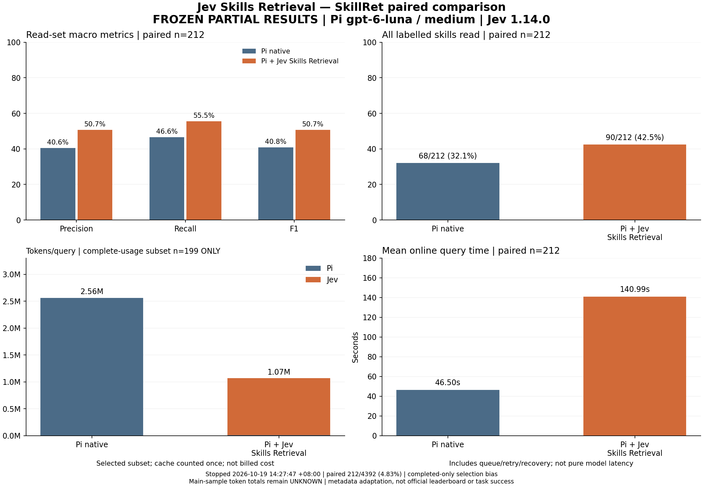

# Jev Skills Retrieval

为 **Pi coding agent** 提供按请求检索的技能目录：Jev 对技能 metadata 评分，Pi 再按原生流程读取选中技能的正文。

每轮只路由一次，工具续跑复用选择；固定技能和显式 `/skill:name` 优先。正常零命中保留空自动目录，服务错误会明确提示并回退；缺少凭据则阻塞当前任务。

## 快速开始

要求 Node.js >=22.19、[Pi 1.3.0](https://github.com/earendil-works/pi/tree/v1.3.0)。在项目根目录运行：

```powershell
npm ci
npm run build
pi -e ./dist/pi-adapter.js
```

在新的 Pi 会话中使用 `/jev-skill apikey` 配置 Jev 凭据，或预先设置 `TYPESAFE_API_KEY`。聊天模型由 Pi 自己配置。命令与旧配置路径保持兼容，详见[使用与配置](docs/configuration.md)。

## 已冻结的阶段结果

SkillRet 的 **212 对共同完成查询**，模型为 Pi OpenAI OAuth `gpt-6-luna` / `medium`，Jev 为 `jev-1.14.0`。两组使用相同的 6,006 个技能。

| 指标 | Pi 原生 | Pi + Jev Skills Retrieval |
| --- | ---: | ---: |
| 成功读取技能集合的宏平均 Precision | 40.55% | 50.73% |
| 宏平均 Recall | 46.62% | 55.50% |
| 宏平均 F1 | 40.83% | 50.68% |
| 读全标注技能 | 68/212 | 90/212 |
| 平均在线查询耗时 | 46.50 s | 140.99 s |

双方用量完整的 **199 对子集**中，平均总 Token/查询为 2.56M 与 1.07M（含 Pi + Jev）。212 对主样本仍有未知用量，总 Token 保持未知。Token 包含缓存，不能据此推算账单费用。



这是用户暂停后的已完成子集，占 4,392 条查询的 4.83%；存在完成样本选择偏差。它采用 metadata 适配协议，**不代表全量结论、官方 SkillRet 榜单或 SkillsBench 实际任务通过率**。耗时包含排队、重试和恢复。

[查看方法、精简证据、CSV、SVG 与离线复核方式](docs/benchmarks/2026-10-19-skillret-paused-212/README.md)。

## 开发与文档

```powershell
npm run check
npm run results:verify
npm run verify:package
```

以上检查不调用线上模型。npm 打包只包含运行代码与使用文档；评测数据和开发材料保留在 Git 仓库。

- [配置、命令与故障处理](docs/configuration.md)
- [架构与数据流](docs/architecture.md)
- [开发与验证](docs/development.md) · [项目约定](AGENTS.md)
- [完整评测操作说明](benchmark/README.md) · [历史验收记录](docs/verification.md)
- [项目开发 Skill](.agents/skills/jev-skills-retrieval-dev/SKILL.md)

当前实现为全量 metadata 分批评分；尚未实现 BM25 或向量预筛选。日常默认总路由时限为 15 秒，大目录需显式调整；不支持运行中插话、接管扩展加载前的历史会话或删除历史技能正文。

MIT License.
