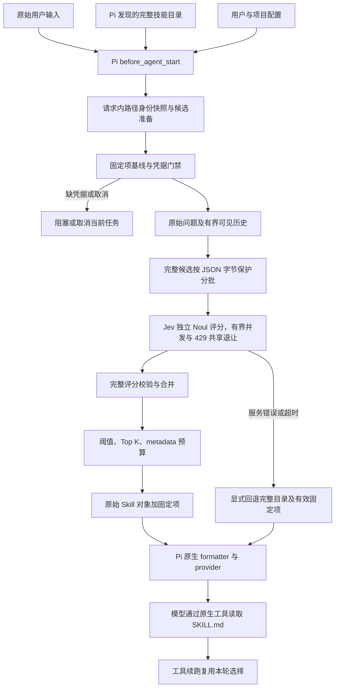

# 架构与数据流

Jev Skills Retrieval 是 Pi 1.3.0 原生 TypeScript 扩展。Pi 负责发现技能、格式化目录、加载显式技能和读取原始正文；扩展只为每条正常用户请求确定本轮活动目录。

## 请求内快照

`src/pi-adapter.ts` 在凭据门禁前创建目录快照。`selection.ts` 为每条路径只解析一次规范身份，复用去重、固定项和候选。成功选择与失败回退使用同一份快照；下一条正常用户请求重新创建，避免复用失效路径。

固定路径只引用 Pi 已发现且仍存在的技能，不触发额外正文加载。显式 `/skill:name` 由 Pi 原生展开，路由上下文保留展开前的用户原文。同轮工具续跑不重复路由。

`context.ts` 保留原始当前输入、有界历史和前轮 metadata。扩展自己的历史仅记录助手可见文本，不吸收工具结果、思考、技能正文或自定义会话条目。已有历史会话重载扩展后跳过路由，需 `/new`；历史中已出现的正文或 prompt delta 不会删除。

## 分批与选择

`batching.ts` 使用与 `jev-client.ts` 相同的请求构造器按确定性顺序装包。默认每批最多 48,000 个未压缩 JSON UTF-8 字节，state 加任意一道题最多 24,000 字节，最多 128 批。它们是字节保护，不能证明满足服务 Token 上限。

日常查询默认 3 个 worker，最多可配置 16 个；每个 worker 的尝试结束后默认间隔 1 秒。
worker 可独立补位，不依赖整组屏障。每个候选只归属一个计划批次，失败重试复用原批次。
全部批次评分成功后才进行统一阈值、Top K 和 Pi formatter metadata 预算筛选。
响应可乱序完成，合并恢复候选原顺序；字符按 JavaScript UTF-16 计算，不是 Token。
固定项和显式正文不占自动预算，没有 BM25/向量预筛选。

SDK 仍零重试；`batching.ts` 独立实现仅针对 429 的额外重试，默认每批 2 次。
429 使本轮后续并发减半（最低 1），更新共享最长冷却；指数退避、正抖动和服务端
Retry-After 均受评估/总时限约束。等待释放 HTTP 槽位，本轮内不恢复较高并发。
致命错误、耗尽或取消停止排队并取消在途，所有已准入尝试结算后才返回，
不会丢弃已知用量或使用部分覆盖。未知 429 用量在重试成功后仍保持未知总量。
成功响应用量未知且覆盖未完成时停止继续工作。
同步尝试回调先于释放槽位；最终报告不重复记账。进度回调只传数量与阶段。
benchmark profile 显式串行、关闭调度重试，保留独立 HTTP 恢复语义。

## 时限与失败

`router.ts` 默认准备 5 秒、评估 10 秒、总计 15 秒，单批 10 秒。准备时间计入总预算，凭据输入/存储等待排除。同步文件操作不能被 JavaScript 定时器抢占，完成后检查时限；SDK、网络和解析计入评估时间。

诊断分别记录 preparation/evaluation/selection 耗时及 timeoutPhase。服务错误明确回退；缺凭据、输入取消、无 UI、保存失败则停止当前 Pi 任务。只允许安全错误码进入日志，不转发任意服务错误正文。已观察到的部分 usage 在后续失败后仍保留。

## 凭据与兼容

`credentials.ts` 优先读 `TYPESAFE_API_KEY`，其次读取专用用户文件，再等待交互输入。Windows 使用当前用户 DPAPI，POSIX 使用 0700 目录/0600 文件。秘密通过子进程 stdin 传入，不放命令参数；不自动持久化环境变量中的 key。

`key-prompt.ts` 为 TUI 掩码弹窗补充剪贴板快捷键；`clipboard.ts` 仅读取文本，
优先使用 Pi 公开原生剪贴板助手，不可用时调用系统工具。异步读取结果在弹窗关闭后丢弃。
`commands.ts` 支持 `/jev-skill apikey add <apikey>`，与弹窗共用 `credentials.ts`
的校验与保存路径；命令不会进入模型会话，但 Pi 编辑器可保留其明文输入历史。

项目和包改名为 `jev-skills-retrieval`，以下接口仍保持原值：

| 接口 | 兼容标识 |
| --- | --- |
| 凭据目录 | `~/.jev-skill-router/credentials.json` |
| 配置文件 | `.pi/skill-router.json`、Pi agent 目录的 `skill-router.json` |
| 命令 | `/jev-skill`、`/skill-router-status` |
| 会话诊断类型 | `jev-skill-router` |
| 评测内部组名 | `native`、`router` |

改展示名不会改写旧检查点、原始归档或本机工作区路径。地址优先级、配置字段和交互细节见[配置文档](configuration.md)。

## 运行可见性与提示词核验

`pi-adapter.ts` 在编辑器上方使用 Pi 原生 widget 显示 `[jev-skills-retrieval]`，
并同步状态栏及状态命令。阶段包括准备目录、凭据等待、Jev 评分（已完成批数）、
筛选完成、完整目录回退、仅固定项、跳过及阻塞。工具续跑复用选择，
相同结果通知和安全会话条目在同轮内去重。

`session_start` 根据会话历史和当前配置发出启动通知，明确插件是否已开启筛选。
正常新会话解释本地目录不自动全量进入系统提示词、选中项/固定项与异常回退；
旧会话、自动筛选关闭、配置有问题分别提示。通知只使用 UI，不产生模型请求或会话消息。

所选技能名称使用已有快照中的 Skill 对象区分自动项与固定项，不再次解析路径。
`prompt-status.ts` 为界面格式化名称；状态栏优先列名称，widget 分行展示，
状态命令提供完整名单。未核验/不一致时明确标为计划，新请求清空旧名单。
名称单独保存在内存中，不并入 `SkillPromptStatus` 或持久化诊断，
回退也不会把完整目录标为自动选择。

`prompt-status.ts` 在本扩展的 `before_provider_request` 检查点，从已知 provider
system 字段按原有顺序提取文本，重放 Pi 1.3.0 的 skills 段替换/移除，
再与 Pi 原生 formatter 的本轮计划输出比较；历史中被替代的目录条目单独计数。
无段标记的附加目录仍算作本轮不一致，不通过“只取最后一个目录”来掩盖改写。
它不读取用户/工具文本，不把完整 payload 写入状态或会话；只有状态与数量进入
独立的 `jev-skill-prompt` 条目。未知/残缺的更新帧、基线归属不明或服务端增量历史
保持未核验。目录不符只显示中立的不一致提示，不把推测原因当成已确认事实。
任务结束即清除核验计划，无关后台请求不复用旧计划；同轮只保留一条冲突界面提示。
后续扩展仍可能改写 payload；核验也不代表 HTTP 已成功发送。
这层只观察，不修改 provider payload、路由结果、尝试回调记账或请求预算。

## 评测隔离

`benchmark/` 通过真实 Pi provider 边界计数。普通离线测试用本机假服务和假 key，不使用真实账户。真实 SkillRet 使用 Pi 原生 OpenAI OAuth `gpt-6-luna` / `medium`；Jev 是独立服务。不能用通用 `LLM_BASE_URL` 代替原生账户，也不能从该 URL 的模型列表推断 OAuth 模型可用性。

协议 2 的串行持久化运行与 `benchmark/parallel/` 协议 3 相互独立。协议 3 两组各有任务池，每组 N=3/5；单查询内部批次仍串行。它在 HTTP 门禁外管理重试、共享冷却及检查点，不改变生产路由的零重试策略。详细操作与恢复边界见[评测说明](../benchmark/README.md)。
